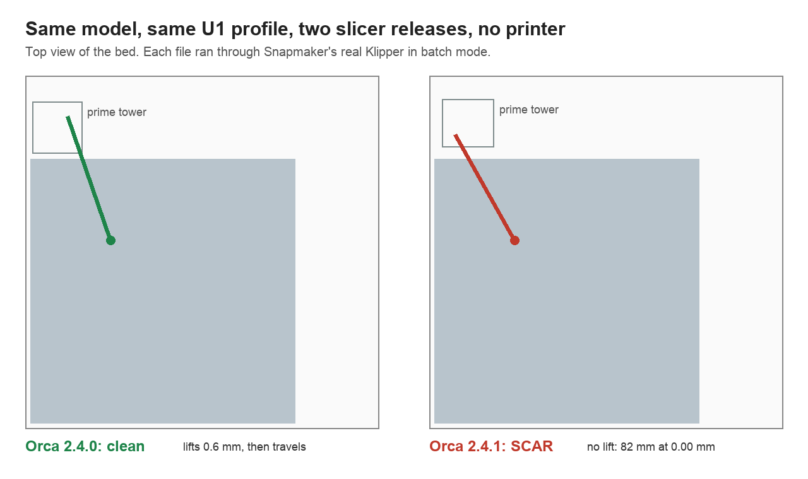

# u1-dryrun

Run a sliced G-code file through Snapmaker's real U1 firmware code, on your laptop or in CI, with no printer attached. In seconds you learn whether the firmware would stop the print, and whether the nozzle would drag across a surface that is already finished.

It runs [Snapmaker/u1-klipper](https://github.com/Snapmaker/u1-klipper) in Klipper's batch mode with Snapmaker's own `printer.cfg`, kinematics, limits and tool-change code. There is no reimplementation of the firmware: if the firmware changes, rebuild against the new commit.

Entered in the Snapmaker Innovation Fund, Phase 2: [U1 Dry Run on the Snapmaker forum](https://forum.snapmaker.com/t/43986). The same firmware runner drives [U1 Fix Pack](https://github.com/DesignMaster-Solutions/u1-fixpack), which reproduces two open u1-klipper bugs and tests a patch for each.

```
$ docker build -t u1-dryrun https://github.com/DesignMaster-Solutions/u1-dryrun.git
$ docker run --rm -v "$PWD:/work" u1-dryrun my-print.gcode.3mf

sign-orca-2.4.1.gcode.gz: 34368 moves, 15 tool changes
motion time 7120 s (no heating), about 53 s of it firmware tool-change motion
  extruder: 91571 mm of filament
  extruder1: 5620 mm of filament
SCAR line 38910 (gcode, extruder1): [65.52, 143.71] -> [19.84, 224.85] at Z3.05 crosses 82.0 mm of finished surface, clearance 0.00 mm
```

Exit code: `0` clean, `1` scars found, `2` the firmware rejected the file. A self-contained `report.html` and `report.json` land in `u1-dryrun-report/`.

It reads files from Snapmaker Orca and from the official OrcaSlicer: real files from both are in [`examples/`](examples/) and run through the firmware on every push.

### Installing Docker

- **macOS or Windows:** install Docker Desktop and start it once.
- **Linux (Ubuntu, Mint, Debian):**
  ```
  sudo apt install docker.io docker-buildx
  sudo usermod -aG docker $USER
  ```
  Then log out and back in, or reboot, so the group change applies. `docker version` should list both Client and Server without a permission error. `$USER` is typed as is; the shell fills in your login name.

Demo video, 2 minutes: https://designmaster-solutions.github.io/u1-dryrun/demo.mp4 (real output, synthetic voice). Sample reports from real runs: [Orca 2.4.0, clean](https://designmaster-solutions.github.io/u1-dryrun/sample/orca-2.4.0.html) [Orca 2.4.1, scar](https://designmaster-solutions.github.io/u1-dryrun/sample/orca-2.4.1.html), and [the 2.4.1 file that scratched a real print](https://designmaster-solutions.github.io/u1-dryrun/sample/pipewrx-helado-2.4.1.html).

## What it found first

In October a user reported on the forum that [Orca 2.4.1 scratches finished prints during the final toolchange, and 2.4.0 does not](https://forum.snapmaker.com/t/snapmaker-orca-2-4-1-nozzle-scratches-prints-during-final-toolchange-works-in-2-4-0/43865). They found it the expensive way: by printing, then comparing G-code by hand.

The same regression shows up here without a printer. Same model, same default U1 profiles, the two official slicer releases, both files in [`examples/`](examples/):

| Slicer | Last move before the final toolchange | Result |
|---|---|---|
| Snapmaker Orca 2.4.0 | lifts to Z3.65, then travels to the tower | clean, exit 0 |
| Snapmaker Orca 2.4.1 | travels to the tower at Z3.05, the height of the surface it just printed | `SCAR line 38910`, 82 mm of finished surface at 0.00 mm clearance, exit 1 |

The missing lift only hurts when the path crosses the part. On the small two-color coaster I tried first, the last extrusion was at the part's edge next to the tower and both versions came out clean. That is why a check on the real toolpath is better than reading the G-code for a `Z` word.



As a fidelity check, the firmware's own motion time lands next to the slicer's estimate, computed by different code: 7120 s against 1h 59m 13s (7153 s) on 2.4.1, and 7264 s against 2h 1m 36s (7296 s) on 2.4.0.

## What it checks

- **Firmware errors.** Anything Klipper would stop on, such as `Move out of range`, a macro error or a bad parameter, with the G-code line. This uses the real limits from Snapmaker's config.
- **Surface scars.** A non-extruding move that crosses printed material with the nozzle within 0.05 mm of it (`--clearance`), for 5 mm or more, where that material is never covered later. Moves are read after the firmware processed them, so tool-change motion issued by the firmware counts too, and ramped lifts are followed along their slope. Prime tower material is ignored.
- **Tool use.** Tool changes, filament per tool, and how much motion time the firmware's tool changes add.

## How it works

1. `Dockerfile` builds the pinned `u1-klipper` commit (Snapmaker's firmware 2.1.0, released 4 November 2026; `--build-arg U1_KLIPPER_REF=93cb12f` builds 2.0.0, and CI runs every check on both) and generates the data dictionaries for its MCUs from Snapmaker's own Kconfig files.
2. `dryrun/prep_cfg.py` comments out the config sections that talk to hardware or services absent here (MQTT, RFID, accelerometers, physical homing). Everything else loads as shipped.
3. `dryrun/prep_gcode.py` tags each move with its line number, homes all axes before the first line, replaces the slicer's start block with `G28` and the first tool, and turns non-ASCII characters (the U1 start G-code has Chinese comments) into `_`, because Klipper's batch reader drops any 4 KB block that cuts a UTF-8 character.
4. `dryrun/dryrun_tracer.py` is a Klipper extras module. It records every `toolhead.move`, turns `G28` into "the axis is at its endstop", and simulates the dock: at the dock Y, sliding X onto a tool's park X releases it and sliding off grabs it. That lets the firmware's own `_cmd_SWITCH_EXTRUDER` run its full sequence and pass its own park and pick checks.
5. `dryrun/analyze.py` builds a height map from the extrusion moves and looks for travel across finished cells.

## What it does not do

**Field report, 2 November 2026.** A U1 owner ran it on Linux Mint on a vanilla OrcaSlicer file they had already printed without trouble ([their post](https://forum.snapmaker.com/t/u1-dry-run-test-a-sliced-file-on-the-real-u1-firmware-no-printer-needed/43986/19)): 1,038,009 moves accepted, 14,091 s of motion for a file named 4h7m (heating is not counted), clean. So a known-good print produced no false alarm on someone else's machine. Their first run also found a real bug, and their output exposed a second one (the [4 KB read](https://github.com/DesignMaster-Solutions/u1-dryrun/commit/786819e) and the [arc attribution](https://github.com/DesignMaster-Solutions/u1-dryrun/commit/6328497)), both fixed the same day.

**First check against a print that really scratched, 4 November 2026.** The user who reported the 2.4.1 regression shared the exact file they printed on their U1 when the nozzle rubbed the part during the final tool change ([their post](https://forum.snapmaker.com/t/43865/3): `helado paleta 2.4.1.gcode`, Snapmaker Orca 2.4.1, sliced 29 October). The tool flags one scar in it, the same on firmware 2.0.0 and 2.1.0: line 130731, inside the last `; CP TOOLCHANGE UNLOAD` block and on the last layer, the nozzle travels from the part (X132.5 Y137.7) to the prime tower (X18.0 Y140.0) at Z12.05 with no lift, across 10.0 mm of finished surface at 0.00 mm clearance, and the retraction only comes after that travel. That is the move they described: the final tool change, on the way to the tower, without enough Z lift ([report](https://designmaster-solutions.github.io/u1-dryrun/sample/pipewrx-helado-2.4.1.html)). They answered on 5 November ([their reply](https://forum.snapmaker.com/t/43865/7)): the scratch is consistent with this move, though they did not measure the exact position on the part, so the match stays by the kind of move and the moment it happens, not by a measured position. They also gave permission to keep the file here, so [`examples/helado-pipewrx-orca-2.4.1.gcode.gz`](examples/helado-pipewrx-orca-2.4.1.gcode.gz) now runs in `tests/e2e.sh` on both firmwares on every change. Their own comparison on this print: Orca 2.4.0 does a 0.40 mm Z-hop before that travel and does not scratch; 2.4.1 does not lift.

- No physics: no heating, no ooze, no flow, no real sensors. Motion time excludes heating waits.
- Commands that wait on hardware are skipped and listed in every report: defect detection, timelapse, auto feed, flow calibration, bed mesh, chamber wait.
- The start block before the first `;LAYER_CHANGE` is not run, because nozzle wiping and probing need sensors and nothing is on the bed yet to scar. Its motion is not checked.
- A scar is a geometric prediction, not a measurement. A soft material or a warped part changes what really happens.

## Use it in CI

```yaml
- uses: DesignMaster-Solutions/u1-dryrun@main
  with:
    gcode: out/plate_1.gcode
```

The step fails on any scar or firmware error, which makes it a regression test for slicer forks, start-gcode changes and firmware mods.

## Development

```
python3 -m unittest discover -s tests   # analysis, no Docker
docker build -t u1-dryrun . && tests/e2e.sh   # real firmware on the example files
```

`examples/flatten_profiles.py` has the profile recipe used to slice the examples with the Snapmaker Orca command line. Its `wipe_tower_filament` removal works around a crash in the CLI when that key is set.

Built by [Design Master Solutions](https://www.designmastersolutions.com/) with AI coding assistance. GPL-3.0, like Klipper. Not affiliated with Snapmaker.
